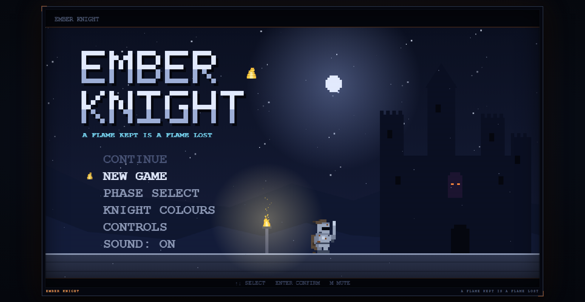
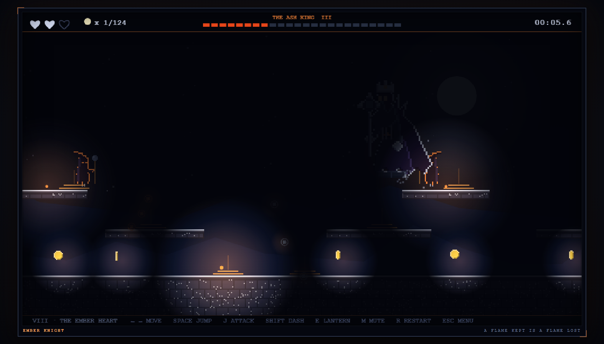

# Ember Knight

**A hand-built pixel platformer. Eight phases, two bosses, one flame.**

`v1.0.0` · JavaScript · Canvas 2D · portable Windows build



---

## Play it

**In a browser** — `https://mores20.github.io/ember-knight1/`
(enable it once in **Settings → Pages → deploy from branch `main` / root**)

**Windows** — download `Ember-Knight-1.0.0.exe` from the [Releases](../../releases) page.
It's portable (no installer, no admin). Windows will say *"unknown publisher"* the
first time — **More info → Run anyway**. Saves live in `%APPDATA%\Ember Knight`.

**From source** —

```
python -m http.server 8000
```

then open `http://127.0.0.1:8000/`. It must be served over HTTP: the game is made of ES
modules and recorded audio, and `file://` blocks both.

## Controls

| Action | Keys |
|---|---|
| Move | `←` `→` or `A` `D` |
| Jump | `Space`, `W`, or `↑` |
| Attack | `J` or `X` |
| Dash | `Shift` |
| Lantern | `E` |
| Menu | `Esc` |
| Mute / Restart | `M` / `R` |
| Fullscreen (desktop build) | `F11` |

## What's inside

- **Eight phases**, from the Ember Road to the Ember Heart, each with its own palette,
  story line and lore, phase select, 124 coins, and a save that survives reloads
- **The Ash Warden** — a melee bruiser whose every move is painted orange first
- **The Ash King** — a mage who floats above the arena and denies the floor. Steel only
  bites while he is stunned: swing his own Ember Bolt back into him to break the ward.
  He scales with his phase (7-drop rain, 6-column eruptions, 4-bolt volleys, chained
  casts) and summons two hexers with piercing orbs
- **The Ash Hexer** — a floating caster whose orbs hex you instead of hurting you:
  Smother dims your light, Heavy Hex locks your dash, Snuff Hex silences your blade
- **Abilities** — the ember dash and the lantern; light-only bridges, the rising tide,
  crumbling platforms and shield-bearing goblins
- **A story** — a prologue, per-phase lore, an ending that earns the title *The Ember
  Knight*, and a credits screen
- **Presentation** — a pixel knight with six colour schemes, a framed 960×540 view with
  status strips, a title-screen diorama, and recorded boss themes, intro voices and
  attack/death stings



## Build your own

```
npm install
npm start        # run in a desktop window
npm run smoke    # automated checks: boot, canvas, audio, a 5s fight
npm run dist     # → dist/Ember-Knight-1.0.0.exe
```

The desktop shell (`app/main.js`) serves the folder on a stable `app://local` origin, so
ES modules load and saves persist; window 1440×900 with a remembered position, `F11`
for fullscreen.

Rebuild `dist/` after changing the game — the exe bundles everything.

## Credits

Created by **LumpiaN#1**. Thanks for playing.

Plain JavaScript (ES modules) and Canvas 2D — no framework, no build step for the game
itself. All pixel art is generated in code; the boss audio is recorded.

© LumpiaN#1 — all rights reserved.
